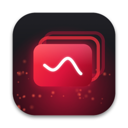
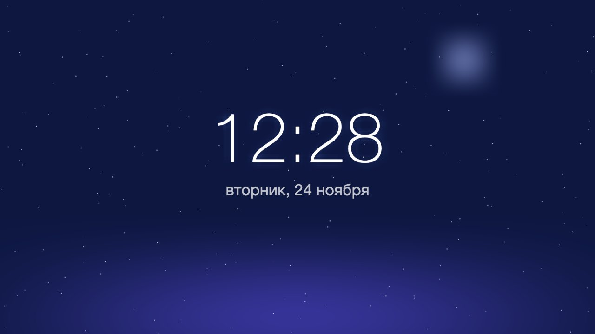
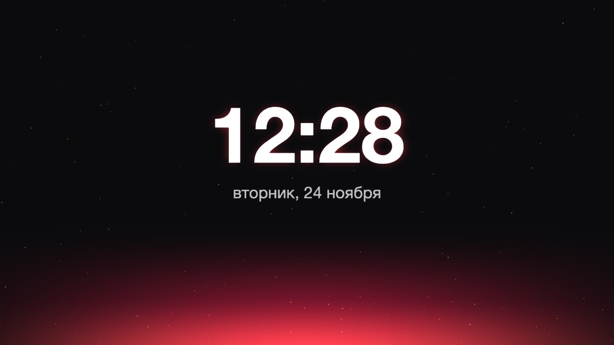
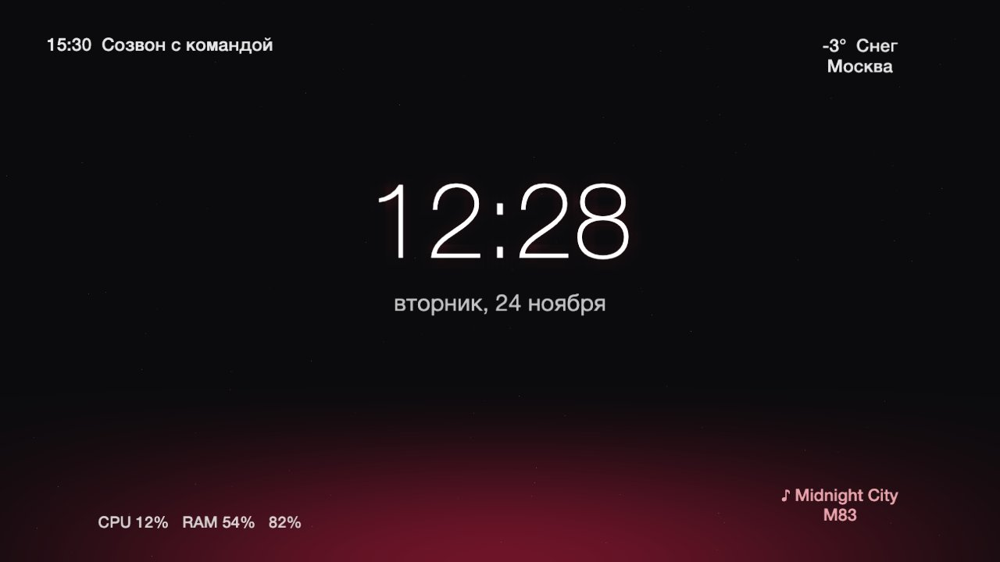
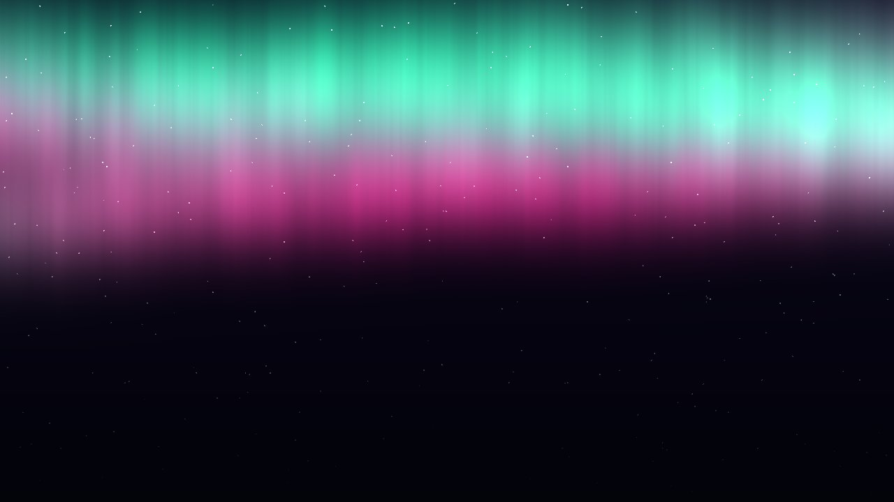
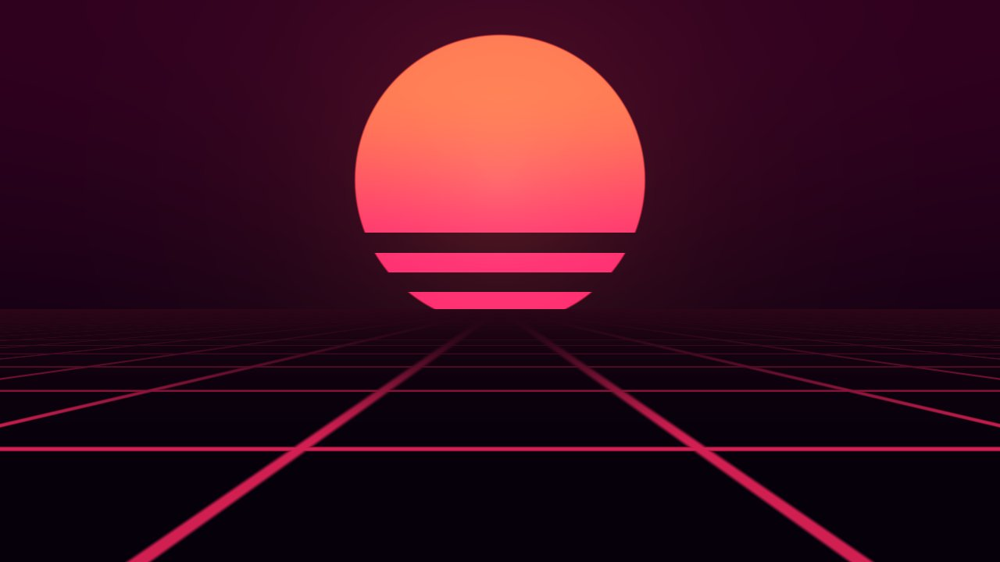
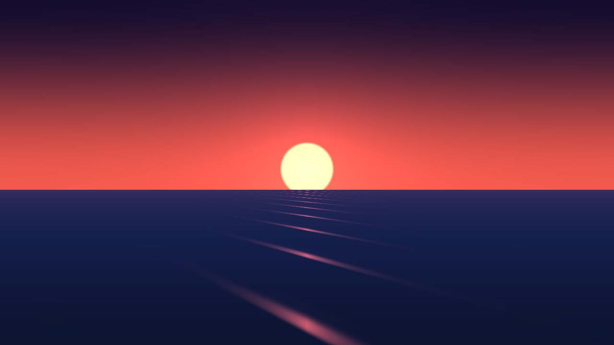

<div align="center">



# LiveWall

**Live wallpapers for macOS**: videos, web pages, GLSL shaders and interactive scenes right beneath your desktop icons.

[](#requirements)
[](#building)
[](LICENSE)
[](https://github.com/Jinjer07/LiveWall/releases/latest)

[Русский](README.md) · **English**

</div>

---

<table>
<tr>
<td></td><td></td><td></td>
</tr>
<tr>
<td></td><td></td><td></td>
</tr>
</table>

## Features

| | |
|---|---|
| 🎬 **6 wallpaper types** | Video (mp4/mov/webm), web (HTML/JS/WebGL), images and GIFs, slideshows, GLSL shaders, layered scenes |
| 🧩 **Wallpaper Engine compatible** | Import your whole Steam Workshop: video and web as is, scenes via the built-in converter (original images, layers, parallax, particles), presets, one-click playlist |
| 🎨 **Scene editor** | Layers, mouse parallax, particles (snow, rain, sparks, fireflies…), waves, glow, color grading, clock and date |
| 🖼 **Gallery** | Ready-made scenes and shaders from this repository, one-click install |
| 🌦 **Time of day & weather** | Scenes get darker at night, warmer at sunset and show rain or snow from real weather |
| 🧭 **Widgets** | CPU, memory, battery, now playing, next calendar event and weather, right on your wallpaper |
| 🔊 **Audio reactive** | System audio spectrum (128 bands, vDSP FFT) for shaders, scenes and web wallpapers |
| ⬆️ **Auto-updates** | A new GitHub release reaches every user: download, verify, relaunch |
| 🔋 **Smart pause** | Full-screen apps, covered desktop, battery, lock and sleep; about 6% CPU at the default 15 fps |
| 🌍 **English and Russian** | Switch the interface language on the fly |

## Install

1. Download the zip from the [latest release](https://github.com/Jinjer07/LiveWall/releases/latest) and unzip it.
2. Move `LiveWall.app` to Applications.
3. The app isn't notarized by Apple, so macOS asks once before opening it:
   - **macOS 14 Sonoma:** right-click LiveWall → Open → Open.
   - **macOS 15 and later (incl. 26–27):** launch it, dismiss the warning, then System Settings → Privacy & Security → “Open Anyway” at the bottom.

Requires macOS 14+ on Apple Silicon (tested on 14.6 and 27.2).

## Building

Only Command Line Tools are needed:

```bash
git clone https://github.com/Jinjer07/LiveWall.git && cd LiveWall && ./build.sh
```

## Docs

User guide, wallpaper formats and architecture are in [`docs/`](docs) (Russian). Shader and scene formats are summarized in [docs/FORMATS.md](docs/FORMATS.md).

## License

[MIT](LICENSE) © 2026 Jinjer07. Inspired by Wallpaper Engine; not affiliated with its authors or Valve.
