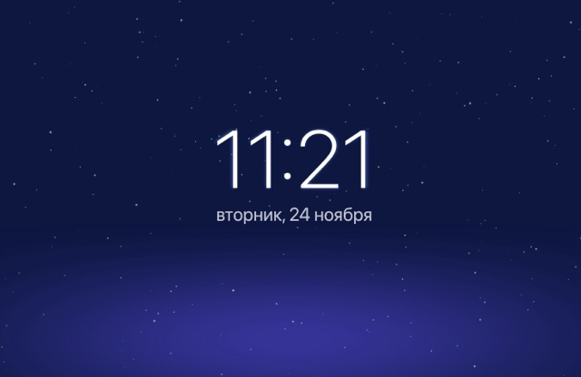
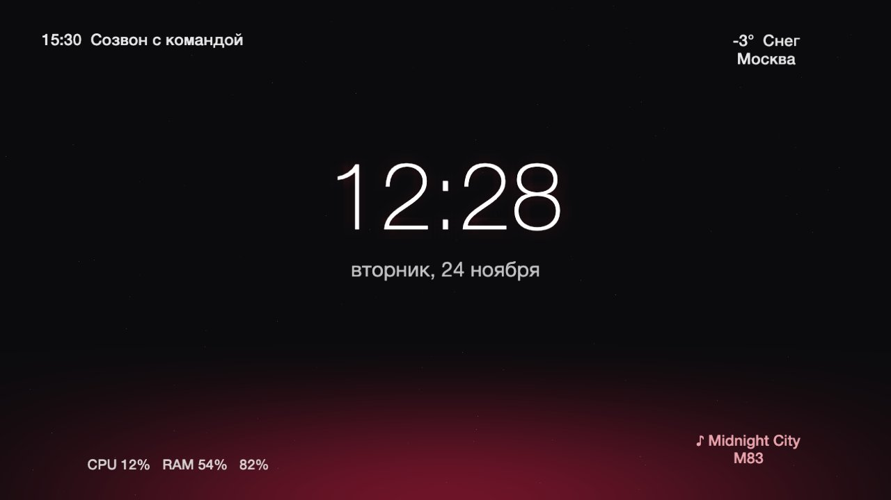

<div align="center">


# LiveWall

**Live wallpapers for macOS**: videos, web pages, GLSL shaders and interactive scenes right beneath your desktop icons.

[](#requirements)
[](#building)
[](LICENSE)
[](https://github.com/Jinjer07/LiveWall/releases/latest)

**English** · [Русский](README.ru.md)

[Features](#features) · [Install](#install) · [Building](#building) · [Docs](#docs) · [Performance](#performance)

</div>

---

<table>
<tr>
<td width="33%"></td>
<td width="33%"></td>
<td width="33%"></td>
</tr>
<tr>
<td align="center"><sub><b>Scene</b>: clock, particles, parallax</sub></td>
<td align="center"><sub><b>Shader</b>: Shadertoy style</sub></td>
<td align="center"><sub><b>Web</b>: audio visualizer</sub></td>
</tr>
</table>

## Features

| | |
|---|---|
| 🎬 **6 wallpaper types** | Video (mp4/mov/webm), web (HTML/JS/WebGL), images and GIFs, slideshows, GLSL shaders, layered scenes |
| 🧩 **Wallpaper Engine compatible** | Import your whole Steam Workshop: video and web as is, scenes via the built-in converter (original images, layers, parallax, particles), presets, one-click playlist |
| 🎨 **Scene editor** | Layers, mouse parallax, particles (snow, rain, sparks, fireflies…), waves, glow, color grading, clock and date |
| 🔊 **Audio reactive** | System audio spectrum (128 bands, vDSP FFT) for shaders, scenes and web wallpapers |
| 🖥 **Multiple displays** | A wallpaper per display, or one stretched across all of them |
| 📚 **Library** | Tags, favorites, search, multi-select (Cmd/Shift-click, Cmd+A, Cmd+Backspace), per-wallpaper settings, `.wallpkg` packages |
| ❄️ **Snow** | Snow over the desktop: drifts settle on windows, the cursor sweeps them away, string lights; separate pause settings |
| ⏱ **Playlists** | Switch on a timer or by time of day; starts right away on launch |
| 🔋 **Smart pause and FPS** | Pauses for full-screen apps, covered desktop, another app focused, battery, lock and sleep; at rest at most 20 fps, up to your limit on mouse movement and music beats |
| ⚡️ **Native scenes** | Scenes are drawn on Metal, without a web engine: about 3–4× less CPU than WebKit |
| 🖼 **Gallery** | Ready-made scenes and shaders from this repository, one-click install |
| 🌦 **Time of day & weather** | Scenes get darker at night, warmer at sunset and show rain or snow from real weather |
| 🧭 **Widgets** | CPU, memory, battery, now playing, next calendar event and weather, right on your wallpaper |
| ⬆️ **Auto-updates** | A new GitHub release reaches every user: download, verify, relaunch |
| 🌍 **English and Russian** | Switch the interface language on the fly |
| 🌑 **Design** | Charcoal and crimson theme, splash screen, onboarding, interface animations |

## Install

1. Download the zip from the [latest release](https://github.com/Jinjer07/LiveWall/releases/latest).
2. Unzip it and move `LiveWall.app` to Applications.
3. The app isn't notarized by Apple (no paid developer certificate), so macOS asks once before opening it:
   - **macOS 14 Sonoma:** right-click LiveWall → Open → Open.
   - **macOS 15 and later (incl. 26–27):** launch LiveWall, dismiss the warning, then System Settings → Privacy & Security → “Open Anyway” at the bottom, and confirm with your password or Touch ID.
4. Go through the short onboarding, and the wallpaper is already on your desktop.

> For audio reactivity macOS asks for the “System Audio Recording Only” permission (macOS 14.2+). The screen is not recorded.

## Gallery

<table>
<tr>
<td></td><td></td><td></td>
</tr>
<tr>
<td></td><td></td><td></td>
</tr>
</table>

The catalog lives in [`gallery/`](gallery). To add a scene or shader, add the file and a preview and append an item to `index.json` (scenes are easy to generate with `tools/build_gallery.py`).

## Updates

LiveWall checks the [latest release](https://github.com/Jinjer07/LiveWall/releases/latest) on launch and every 6 hours. When a new version is out, a “Version X is available” banner with an “Update” button appears. The zip is downloaded, checked against the SHA-256 in the release notes, swapped in, and the app relaunches.

To ship an update: bump `CFBundleShortVersionString` in `Info.plist`, build with `./build.sh`, create a release tagged `vX.Y.Z`, attach the zipped `LiveWall.app`, and put a `SHA-256: <hash>` line in the release notes.

## Requirements

- macOS 14 Sonoma or later (tested on 14.6 and 27.2)
- Apple Silicon (the release build is arm64)

## Building

Only Command Line Tools are needed (`xcode-select --install`); Xcode is optional.

```bash
git clone https://github.com/Jinjer07/LiveWall.git
cd LiveWall
./build.sh
open build/LiveWall.app
```

`build.sh` compiles the sources directly with `swiftc`, assembles the `.app` and signs it with the `LiveWall Code Signing` certificate if it is in your keychain (ad-hoc otherwise). A stable signature keeps macOS from resetting granted permissions after every rebuild. Use `LIVEWALL_SIGN_IDENTITY` to pick your own certificate. The icon is generated by `tools/make_icon.swift`.

## Performance

Live wallpapers cost resources by nature: every frame makes WindowServer recomposite the screen. LiveWall does everything it can to draw as few frames as possible:

| Mode | Load (MacBook M3, “Night clock” scene) |
|---|---|
| Paused (desktop covered, full-screen app, battery) | **≈ 0%** |
| 15 FPS (default) | **≈ 6%** total |
| 24 FPS | ≈ 14–20% |
| Before optimization (30 FPS) | ≈ 42% |

How: a custom frame scheduler with an FPS limit and an adaptive boost on mouse movement, 1× rendering instead of Retina doubling, an opaque WebView, no `preserveDrawingBuffer`, pausing when the desktop is covered, and unloading the whole interface while the app window is closed.

The snow overlay is drawn by the CPU on a transparent full-screen layer, so it adds its own load while it's on. It is off by default and has its own pause settings.

## Docs

- 📘 [User guide](docs/USER_GUIDE.md)
- 🧪 [Wallpaper formats: shaders, scenes, web API, packages](docs/FORMATS.md)
- 🏗 [Architecture](docs/ARCHITECTURE.md)
- 📝 [Changelog](CHANGELOG.md)

## Credits

Inspired by [Wallpaper Engine](https://www.wallpaperengine.io/). LiveWall is an independent project and is not affiliated with its authors or with Valve. Steam and steamcmd are trademarks of Valve Corporation.

Snow, multi-select and several fixes in 1.6.0 were contributed by [@Nanda070](https://github.com/Nanda070).

## License

[MIT](LICENSE) © 2026 Jinjer07
