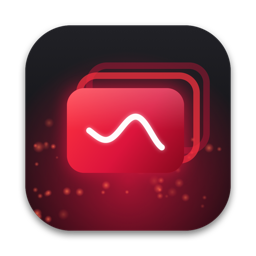
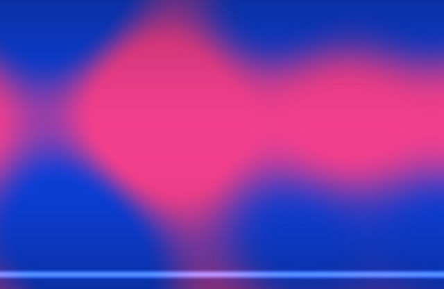
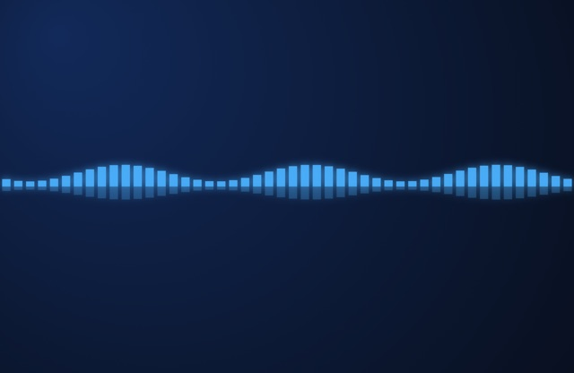
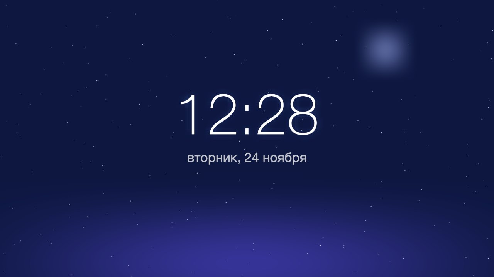
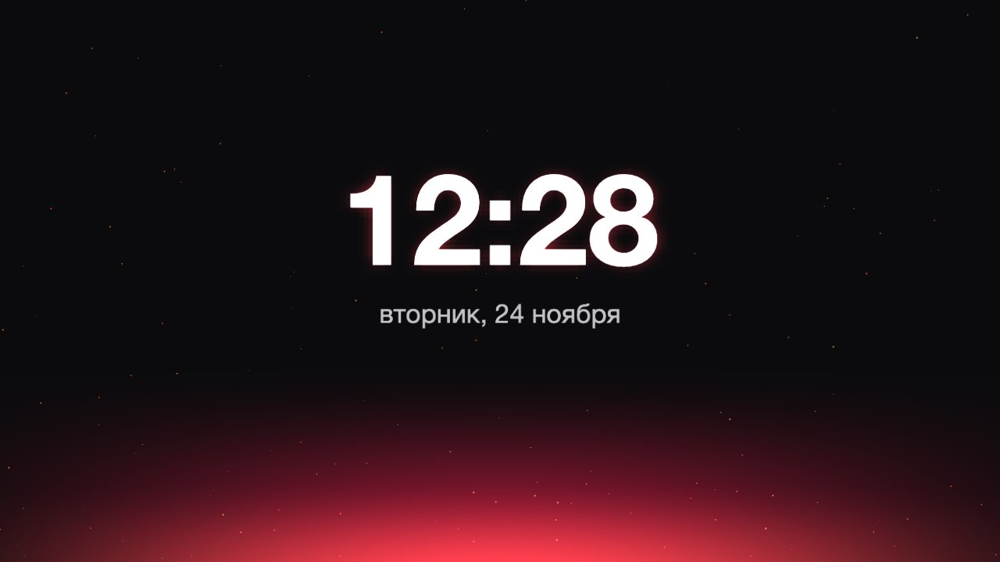
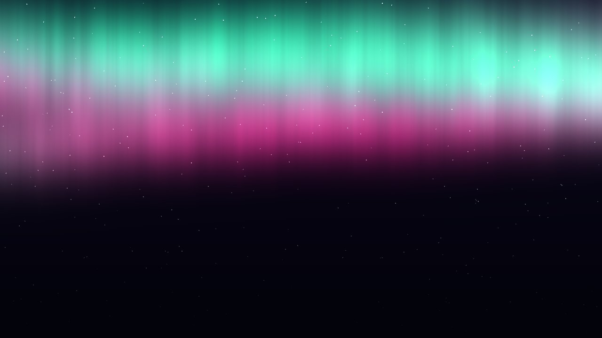
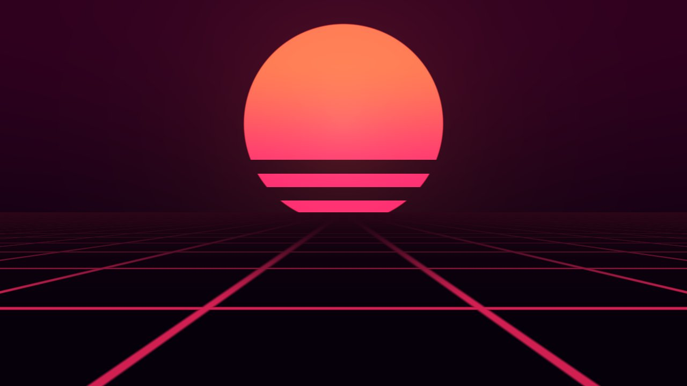

<div align="center">



# LiveWall

**Живые обои для macOS** — видео, веб-страницы, GLSL-шейдеры и интерактивные сцены прямо под иконками рабочего стола.

[](#требования)
[](#сборка)
[](LICENSE)
[](https://github.com/Jinjer07/LiveWall/releases/latest)

**Русский** · [English](README.en.md)

[Возможности](#возможности) · [Установка](#установка) · [Сборка](#сборка) · [Документация](#документация) · [Производительность](#производительность)

</div>

---

<table>
<tr>
<td width="33%"></td>
<td width="33%"></td>
<td width="33%"></td>
</tr>
<tr>
<td align="center"><sub><b>Сцена</b> — часы, частицы, параллакс</sub></td>
<td align="center"><sub><b>Шейдер</b> — в стиле Shadertoy</sub></td>
<td align="center"><sub><b>Веб</b> — визуализатор звука</sub></td>
</tr>
</table>

## Возможности

| | |
|---|---|
| 🎬 **6 типов обоев** | Видео (mp4/mov/webm), веб (HTML/JS/WebGL), картинки и GIF, слайдшоу, GLSL-шейдеры, сцены из слоёв |
| 🧩 **Совместимость с Wallpaper Engine** | Веб-обои работают с `wallpaperPropertyListener` и `wallpaperRegisterAudioListener`; импорт video/web-проектов из мастерской Steam |
| 🎨 **Редактор сцен** | Слои, параллакс от мыши, частицы (снег, дождь, искры, светлячки…), волны, свечение, цветокоррекция, часы и дата |
| 🔊 **Реакция на звук** | Спектр системного звука (128 полос, FFT на vDSP) для шейдеров, сцен и веб-обоев |
| 🖥 **Несколько мониторов** | Свои обои на каждый экран или одни растянутые на все |
| 📚 **Библиотека** | Теги, избранное, поиск, настройки каждых обоев, пакеты `.wallpkg` |
| ⏱ **Плейлисты** | Смена по таймеру или по времени суток |
| 🔋 **Умная пауза** | Полноэкранные приложения, закрытый окнами рабочий стол, батарея, блокировка, сон |
| 🖼 **Галерея** | Готовые сцены и шейдеры из репозитория — установка в один клик |
| 🌦 **Время суток и погода** | Сцены темнеют ночью, теплеют на закате, показывают дождь и снег по реальной погоде |
| 🧭 **Виджеты** | CPU, память, батарея, «Сейчас играет», ближайшее событие календаря, погода — прямо на обоях |
| ⬆️ **Автообновления** | Новый релиз на GitHub сразу приходит всем пользователям: скачать → проверить → перезапустить |
| 🌍 **Русский и English** | Язык интерфейса меняется на лету |
| 🌑 **Дизайн** | Угольно-алая тема, заставка, онбординг, анимации интерфейса |

## Установка

1. Скачайте `LiveWall-1.0.0-macOS-arm64.zip` со страницы [последнего релиза](https://github.com/Jinjer07/LiveWall/releases/latest).
2. Распакуйте и перенесите `LiveWall.app` в «Программы».
3. Приложение подписано ad-hoc (без сертификата разработчика), поэтому при первом запуске: **правый клик → Открыть → Открыть**.
4. Пройдите короткий онбординг — и обои уже на рабочем столе.

> Для реакции на звук macOS попросит разрешение «Запись экрана и системного звука». Изображение экрана не записывается — используется только звук.

## Галерея

<table>
<tr>
<td></td><td></td><td></td>
</tr>
<tr>
<td></td><td></td><td></td>
</tr>
</table>

Каталог лежит в [`gallery/`](gallery): чтобы добавить сцену или шейдер, положите файл и превью и допишите элемент в `index.json` (сцены удобно генерировать скриптом `tools/build_gallery.py`).

## Обновления

LiveWall сам проверяет [последний релиз](https://github.com/Jinjer07/LiveWall/releases/latest) при запуске и раз в 6 часов. Когда выходит новая версия, появляется баннер «Доступна версия X» и кнопка «Обновить». Архив скачивается, сверяется с SHA-256 из описания релиза, приложение подменяется и перезапускается.

Как выпустить обновление: поднимите `CFBundleShortVersionString` в `Info.plist`, соберите `./build.sh`, создайте релиз с тегом `vX.Y.Z` и приложите `LiveWall-X.Y.Z-macOS-arm64.zip`, указав в описании строку `SHA-256: <хэш>`.

## Требования

- macOS 14 Sonoma или новее
- Apple Silicon (сборка релиза — arm64)

## Сборка

Нужны только Command Line Tools (`xcode-select --install`), Xcode не обязателен.

```bash
git clone https://github.com/Jinjer07/LiveWall.git
cd LiveWall
./build.sh
open build/LiveWall.app
```

`build.sh` компилирует исходники напрямую через `swiftc` и собирает `.app`. Иконка генерируется скриптом `tools/make_icon.swift`.

## Производительность

Живые обои по природе тратят ресурсы: каждый кадр заставляет WindowServer пересобрать экран. LiveWall делает всё, чтобы кадров было как можно меньше:

| Режим | Нагрузка (MacBook M3, сцена «Ночные часы») |
|---|---|
| Пауза (рабочий стол закрыт окнами, полноэкранное приложение, батарея) | **≈ 0 %** |
| 15 FPS (по умолчанию) | **≈ 6 %** суммарно |
| 24 FPS | ≈ 14–20 % |
| До оптимизации (30 FPS) | ≈ 42 % |

Что сделано: собственный планировщик кадров с лимитом FPS и адаптивным ускорением при движении мыши, рендер в 1× вместо Retina-удвоения, непрозрачный WebView, отказ от `preserveDrawingBuffer`, пауза при перекрытии рабочего стола и полная выгрузка интерфейса, когда окно приложения закрыто.

## Документация

- 📘 [Руководство пользователя](docs/USER_GUIDE.md)
- 🧪 [Форматы обоев: шейдеры, сцены, веб-API, пакеты](docs/FORMATS.md)
- 🏗 [Архитектура](docs/ARCHITECTURE.md)
- 📝 [История изменений](CHANGELOG.md)

## Благодарности

Вдохновлено [Wallpaper Engine](https://www.wallpaperengine.io/). LiveWall — независимый проект и не связан с его авторами или с Valve. Steam и steamcmd — товарные знаки Valve Corporation.

## Лицензия

[MIT](LICENSE) © 2026 Jinjer07
