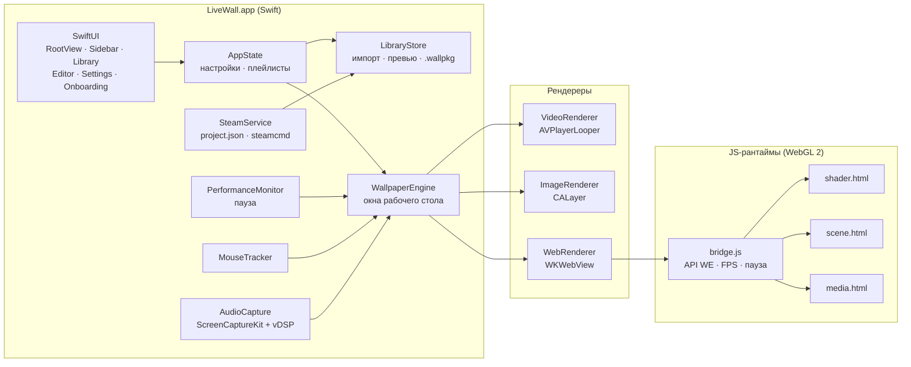

# Архитектура

## Окно рабочего стола

`DesktopWindow` — окно без рамки с уровнем `kCGDesktopWindowLevel`: выше системной картинки, ниже иконок Finder. Поведение `canJoinAllSpaces | stationary` держит его на всех рабочих столах, а `ignoresMouseEvents` пропускает клики к иконкам. На каждый экран создаётся своё окно. В режиме «растянуть» рендерер получает кадр объединения всех экранов и сдвигается внутри окна.

## Рендереры

| Тип | Рендерер | Как |
|---|---|---|
| Видео mp4/mov/m4v | `VideoRenderer` | `AVQueuePlayer` + `AVPlayerLooper` (бесшовный цикл) |
| Видео webm, GIF | `WebRenderer(.media)` | `<video>` / `` в `media.html` |
| Картинка, слайдшоу | `ImageRenderer` | `CALayer` + `CATransition` |
| Веб | `WebRenderer(.web)` | Страница пользователя + мост |
| Шейдер | `WebRenderer(.shader)` | `shader.html`: обёртка Shadertoy на WebGL 2 |
| Сцена | `WebRenderer(.scene)` | `scene.html`: спрайты, частицы и текст на WebGL 2 |

## Мост (bridge.js)

Встраивается в каждую страницу на `documentStart`:

- реализует `wallpaperPropertyListener`, `wallpaperRegisterAudioListener`, паузу и громкость медиа;
- **заменяет `requestAnimationFrame` собственным планировщиком на таймерах**. Окно на уровне рабочего стола macOS считает перекрытым (поверх него лежит прозрачное окно иконок Finder), и WebKit перестаёт вызывать нативный rAF. Планировщик заодно ограничивает FPS, ускоряется до 30 FPS при движении мыши и рисует стоп-кадр на паузе;
- синтезирует события мыши, потому что само окно их не получает.

## Производительность

Основная стоимость живых обоев — сам факт нового кадра: WKWebView передаёт дерево слоёв в процесс приложения, и WindowServer пересобирает весь экран. Поэтому оптимизации нацелены на то, чтобы кадров было меньше и они были дешевле:

1. Пауза, когда обоев не видно: полноэкранное приложение, рабочий стол закрыт окнами на ≥85 % (сетка 24×16 точек по `CGWindowList`), блокировка, сон, батарея.
2. Лимит FPS (15 по умолчанию) с адаптивным ускорением при движении мыши.
3. Рендер сцен в 1× (настройка «Качество»), без `preserveDrawingBuffer`, контекст `low-power`.
4. Непрозрачный WKWebView — без смешивания с нижними слоями.
5. Когда главное окно закрыто, свёрнуто или перекрыто, его интерфейс SwiftUI выгружается, и бесконечные анимации не будят процесс.

## Звук

`AudioCapture` запускает `SCStream` с `capturesAudio = true` (видео 2×2 пикселя, 1 кадр/с), собирает блоки по 1024 сэмпла и считает FFT через `vDSP_fft_zrip` с окном Ханна. Получаются 64 логарифмические полосы от 40 Гц до 16 кГц на канал со сглаживанием атаки и спада, до 30 раз в секунду.

## Сборка без Xcode

`build.sh` вызывает `swiftc` напрямую со всеми исходниками (`-parse-as-library`), кладёт бинарник в `.app`, копирует `Info.plist` и `AppIcon.icns` и подписывает ad-hoc. `Package.swift` оставлен для Xcode и SwiftPM.
