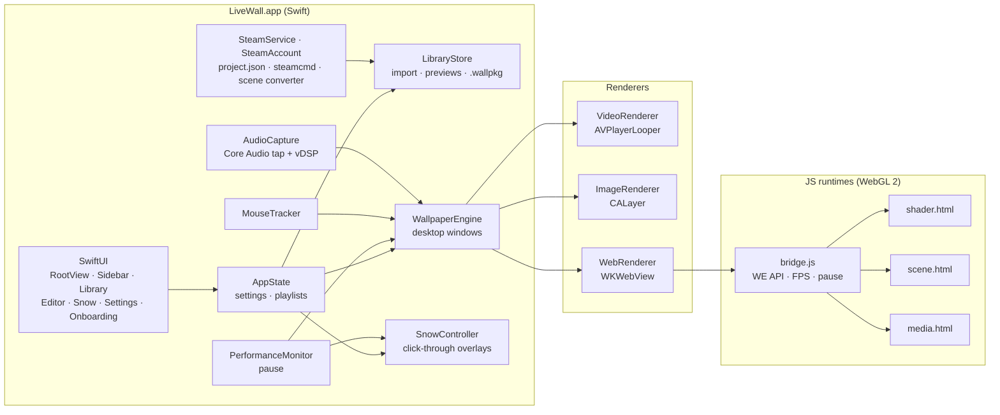

# Architecture

## Desktop window

`DesktopWindow` is a borderless window at `kCGDesktopWindowLevel`: above the system picture, below Finder's icons. The `canJoinAllSpaces | stationary` behavior keeps it on every Space, and `ignoresMouseEvents` lets clicks through to the icons. Each display gets its own window. In “stretch” mode the renderer gets the union of all displays and is offset inside each window.

## Renderers

| Type | Renderer | How |
|---|---|---|
| Video mp4/mov/m4v | `VideoRenderer` | `AVQueuePlayer` + `AVPlayerLooper` (seamless loop) |
| Video webm, GIF | `WebRenderer(.media)` | `<video>` / `` in `media.html` |
| Image, slideshow | `ImageRenderer` | `CALayer` + `CATransition` |
| Web | `WebRenderer(.web)` | The user's page plus the bridge |
| Shader | `WebRenderer(.shader)` | `shader.html`: a Shadertoy wrapper on WebGL 2 |
| Scene | `WebRenderer(.scene)` | `scene.html`: sprites, particles and text on WebGL 2 |

## Bridge (bridge.js)

Injected into every page at `documentStart`:

- implements `wallpaperPropertyListener`, `wallpaperRegisterAudioListener`, media pause and volume;
- **replaces `requestAnimationFrame` with a timer-based scheduler**. macOS treats a desktop-level window as occluded (Finder's transparent icon window sits on top of it), so WebKit stops calling the native rAF. The scheduler also enforces the FPS limit, boosts to 30 FPS on mouse movement and draws a still frame while paused;
- synthesizes mouse events, because the window itself doesn't receive any.

## Snow overlay

`SnowController` creates one `SnowOverlay` per display: a transparent, click-through window at the floating level. `SnowCanvas` simulates the flakes (depth layers, wind, cursor push) and draws them with Core Graphics through a `CADisplayLink` at up to 30 FPS. About ten times a second it reads window frames from `CGWindowList` (frames only, no permissions) to keep drifts on the top edges of windows. Snow has its own pause rules, independent of the wallpaper ones.

## Performance

The main cost of a live wallpaper is the fact of a new frame: WKWebView ships its layer tree to the app process and WindowServer recomposites the whole screen. So the optimizations aim for fewer and cheaper frames:

1. Pause when the wallpaper isn't visible: full-screen app, ≥85% of the desktop covered by windows (a 24×16 grid of points over `CGWindowList`), another app focused (optional), lock, sleep, battery.
2. An FPS limit (15 by default) with an adaptive boost on mouse movement.
3. Scenes render at 1× (the “Quality” setting), without `preserveDrawingBuffer`, with a `low-power` context.
4. An opaque WKWebView, so nothing is blended with the layers below.
5. When the main window is closed, minimized or covered, its SwiftUI interface is unloaded, so endless animations don't wake the process. The audio meter and LIVE dot run on Core Animation.

## Audio

On macOS 14.2+ `AudioCapture` creates a Core Audio process tap (`CATapDescription`) on an aggregate device, which needs only the “System Audio Recording Only” permission. On older systems it falls back to an `SCStream` with `capturesAudio = true` (2×2 pixel video, 1 frame/s). Samples are collected in blocks of 1024 and run through an FFT with `vDSP_fft_zrip` and a Hann window. The result is 64 logarithmic bands from 40 Hz to 16 kHz per channel, with attack and release smoothing, up to 30 times a second.

## Building without Xcode

`build.sh` calls `swiftc` directly with all the sources (`-parse-as-library`), puts the binary into the `.app`, copies `Info.plist` and `AppIcon.icns`, and signs it with the `LiveWall Code Signing` certificate (ad-hoc if it's missing). `Package.swift` is kept for Xcode and SwiftPM.
